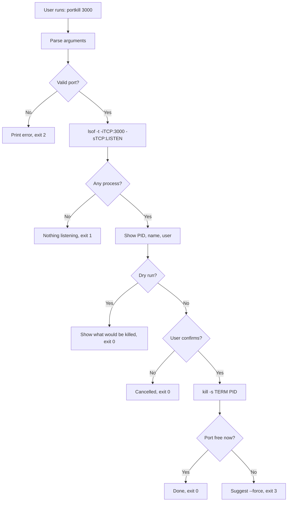

# portkill

> `portkill` — finds whatever program is blocking a network port and stops it, in one command instead of two.

**Team:** Nilesh Verma (Roll No. 58), Tirth Jagtap (Roll No. 38)
**Repository:** https://github.com/NileshVerma800/portkill
**Date:** 28-10-2026

> **About this assignment (Linux subject):** We were asked to take **two Linux commands, merge them into one tool**, and make the output easier for the user. `portkill` merges **`lsof`** (find which process is using a port) and **`kill`** (stop that process).

---

## 1. The problem

When we run a local server (Node, Python, FastAPI, React dev server) and close the terminal wrongly, or the program crashes, the port stays busy. The next time we start the server we get:

```
Error: listen EADDRINUSE: address already in use :::3000
```

### What we keep doing by hand

```bash
lsof -i :3000          # 1. find who is using the port
# read the output, copy the PID by hand (e.g. 48213)
kill 48213             # 2. stop it
lsof -i :3000          # 3. check again that it is really free
# if still busy:
kill -9 48213
```

That is 3–4 commands, plus manually reading a wide table and copying a number.

### Evidence that this is real

```bash
history | grep -E "lsof -i|kill " | wc -l
```

```
3
```

We ran this on a freshly installed WSL Ubuntu, so the history is short and these 3 matches come from our own testing session; most of our earlier work was done in Git Bash on Windows, where `lsof` is not available at all. In practice we hit "address already in use" whenever a dev server is not shut down cleanly, and each time it costs 1–2 minutes of finding and copying a PID, with the risk of killing the wrong program.

### Who else has this problem

Anyone who runs a local dev server (Node, Python, React) can hit this. "How to kill a process running on a particular port in Linux" is one of the most-viewed Linux questions on Stack Overflow, which shows it is a common problem, not just ours.

---

## 2. Prior art — what already exists

### Tools we found and actually tried

| Tool | Where we found it | What it does | Why it does not solve our problem |
|---|---|---|---|
| `fuser -k 3000/tcp` | `man -k port`, already installed (psmisc) | Kills every process using the port | Kills immediately and silently — no list of what will die, no confirmation, no dry run. Also matches clients, not only the server. |
| `npx kill-port 3000` | npm | Kills the process on a port | Needs Node.js + internet download; no preview of which program it is killing. |
| `lsof -i :3000` + `kill <pid>` | built-in | Shows process, then kills it by PID | Works, but is two separate steps with manual PID copying (the problem itself). |

### Evidence of trying them

```bash
# what we ran
fuser -k 3000/tcp
```

```
3000/tcp:             1206
```

`fuser` got the core job right: it found the PID and killed it in one line. What was missing is **safety and clarity** — it did not show the program name, did not ask "are you sure?", and has no dry-run mode, so we could not check before killing.

### Where we searched

- [x] `man -k port` / `man -k kill` — found `fuser`, `lsof`, `kill`, `pkill`
- [x] GitHub search: "kill port"
- [ ] Homebrew: `brew search port` (we use Linux, not macOS)
- [x] Stack Overflow — "How to kill a process running on a particular port in Linux" is a very common question
- [x] npm — found `kill-port`

### The gap, in one sentence

"Existing tools can **kill whatever is on a port**, but none of them **show the program name first, ask for confirmation, offer a dry run, and verify the port is really free afterwards — using only built-in Linux commands**, which is the part that actually costs us time."

---

## 3. What we are building

### In scope

- Take a port number and find the process **listening** on it (using `lsof`).
- Show PID, program name and owner in a short, readable line.
- Ask for confirmation before killing; `--yes` skips it, `--dry-run` only shows.
- Stop the process with `kill` (SIGTERM, or SIGKILL with `--force`).
- Check that the port is actually free afterwards and report it.

### Out of scope

- **UDP ports** — our problem is always TCP dev servers; keeps the tool simple.
- **Killing by process name** (`pkill` already does this well).
- **Windows / macOS support** — this is a Linux subject assignment.

### How we will know it worked

"This tool is successful if it turns **3–4 commands plus copying a PID by hand** into **one command (`portkill 3000`)**, and we actually use it after the assignment ends."

---

## 4. Tech stack

| Choice | What we picked | Why, and what we rejected |
|---|---|---|
| Language | Bash | The tool just glues `lsof` and `kill`; Bash does that natively. Python was rejected — extra dependency for 100 lines. |
| Argument parsing | `while` + `case` loop | Supports long flags (`--dry-run`) which `getopts` does not. |
| Other dependencies | `lsof`, `ps`, `kill` | Already present on most Linux systems. |
| Testing | Manual tests with a dummy server (`python3 -m http.server 3000`) | `bats` was considered but is overkill for this size. |
| Packaging / install method | Copy to `/usr/local/bin` | No package manager needed. |

### Why this language

This is a Linux subject assignment about combining shell commands, so Bash is the natural choice: every step of the tool is already a shell command, and we both use Bash daily.

### What we are deliberately not using

We are not using Python or Node because the tool would then need an interpreter just to call `lsof` and `kill`.

---

## 5. Architecture



### Components

| Part | Responsibility | File |
|---|---|---|
| Argument parser | Reads flags and port, validates input | `portkill` (top) |
| Finder (`lsof`) | Gets PIDs listening on the port | `portkill` (step 1) |
| Display (`ps`) | Converts PID into program name + owner | `portkill` |
| Killer (`kill`) | Sends the signal and verifies the port is free | `portkill` (step 2) |

### Data flow

Input is a port number from the command line. `lsof` turns it into a list of PIDs, `ps` turns each PID into a readable name, and `kill` stops them. Output is a short message and an exit code.

### What happens when things go wrong

| If this happens | The tool does this |
|---|---|
| Port is not a number / out of range | Prints a clear error, exits with code 2 |
| Nothing is using the port | Says "Nothing is listening on port X", exits 1 |
| Process belongs to another user (permission denied) | Suggests `sudo portkill X`, exits 3 |
| Process ignores SIGTERM | Says port is still busy, suggests `--force`, exits 3 |
| `lsof` not installed | Tells user `sudo apt install lsof`, exits 4 |

---

## 6. Usage

### Synopsis

```
portkill [options] <port>
```

### Commands and flags

| Flag | Long form | What it does | Default |
|---|---|---|---|
| `-h` | `--help` | Show usage and exit | |
| `-n` | `--dry-run` | Show what would be killed, change nothing | off |
| `-y` | `--yes` | Don't ask for confirmation | off (asks) |
| `-f` | `--force` | Use SIGKILL (`kill -9`) instead of SIGTERM | SIGTERM |
| `-V` | `--version` | Show version | |

### Examples

> Start a test server first so there is something to kill: `python3 -m http.server 3000 &`

> Output below is real, from our WSL Ubuntu machine (user `tdn`).

**With a flag (safe for live demo)**

```bash
$ portkill --dry-run 3000
```

```
Port 3000 is in use by:
  PID 1209     python3            user: tdn
[dry-run] Would send SIGTERM to: 1209
```

**Basic use**

```bash
$ portkill 3000
```

```
Port 3000 is in use by:
  PID 1209     python3            user: tdn
Kill these process(es)? [y/N] y
Done. Port 3000 is now free.
```

**When nothing is on the port**

```bash
$ portkill 3000
```

```
Nothing is listening on port 3000.
```

**When it fails**

```bash
$ portkill --nonsense
```

```
portkill: unknown option '--nonsense'
Try 'portkill --help' for more information.
```

```bash
$ portkill 99999
```

```
portkill: port must be between 1 and 65535
```

### Before vs after

| Before (by hand) | After |
|---|---|
| `lsof -i :3000` → read table → copy PID → `kill 48213` → `lsof -i :3000` again | `portkill 3000` |

### Exit codes

| Code | Meaning |
|---|---|
| 0 | Success (killed, dry run, or user cancelled) |
| 1 | Nothing is listening on that port |
| 2 | Wrong usage / invalid port |
| 3 | Could not kill (permission denied or process still alive) |
| 4 | `lsof` is not installed |

### Compatibility

| Environment | Works? | Why |
|---|---|---|
| Linux (Ubuntu / Debian) | Yes | `lsof`, `ps` and `kill` are available |
| WSL (Ubuntu on Windows) | Yes | Real Linux; install `lsof` if missing |
| Git Bash on Windows | No | Git Bash does not include `lsof`, and Windows processes are not visible to it |
| macOS | Mostly | `lsof` is built in; not fully tested by us |

### Installation

```bash
git clone https://github.com/NileshVerma800/portkill.git
cd portkill
chmod +x portkill
sudo cp portkill /usr/local/bin/      # now "portkill" works from anywhere
sudo apt install lsof                 # only if lsof is missing
portkill --help
```

---

## 7. References

- `man lsof` — learned `-t` (print only PIDs) and `-sTCP:LISTEN` (only listening servers)
- `man kill` / `man 7 signal` — difference between SIGTERM (polite) and SIGKILL (force)
- `man fuser` — the closest existing tool; compared against it in Section 2
- [kill-port on npm](https://www.npmjs.com/package/kill-port) — existing Node.js tool for the same job
- [Stack Overflow: kill process on a port in Linux](https://stackoverflow.com/questions/11583562/how-to-kill-a-process-running-on-particular-port-in-linux) — showed this is a common problem
